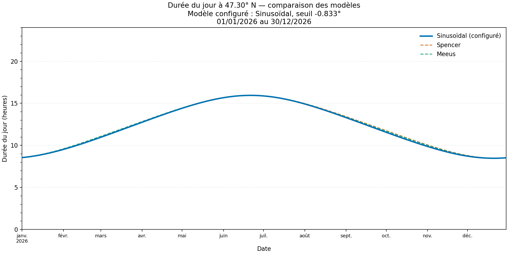
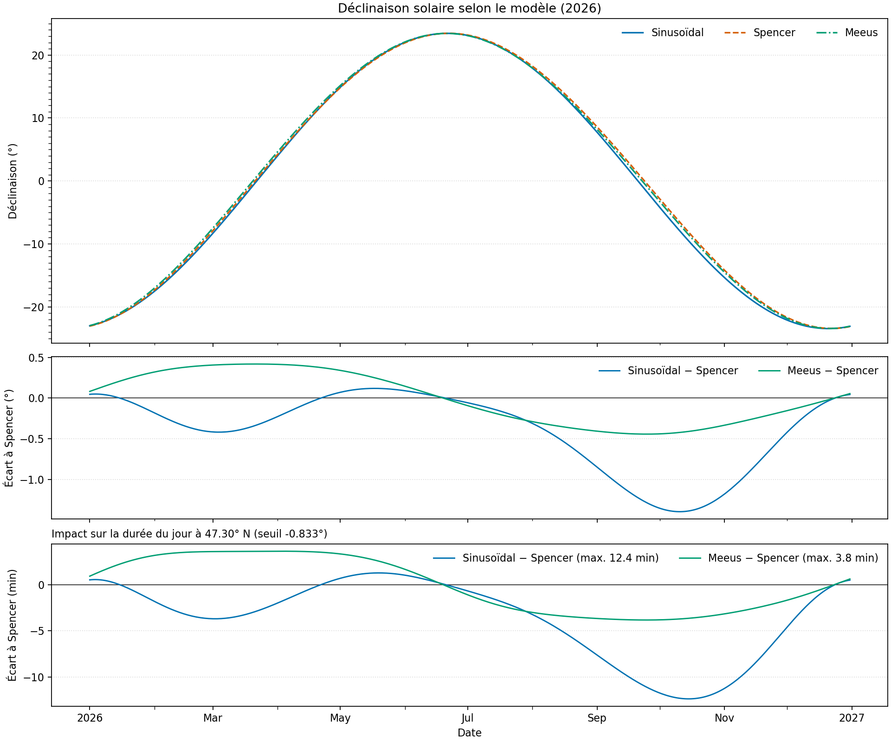
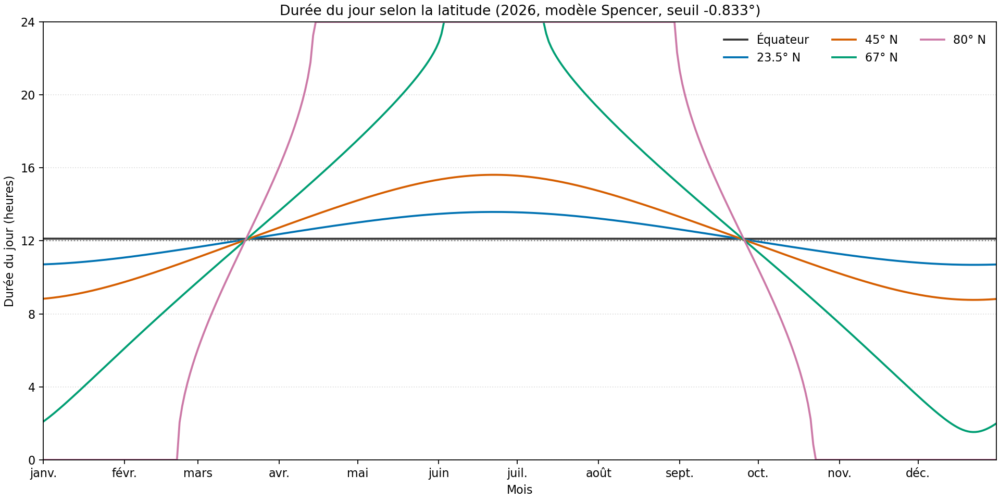
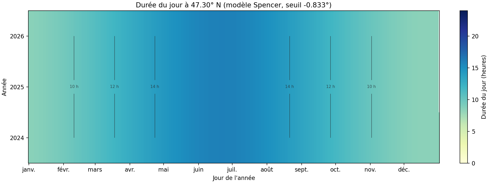

# Fichiers de données et sorties

Ce guide décrit les fichiers d'entrée, les artefacts générés et les visuels du
projet. Les sorties d'exécution sont créées à la demande; des exemples PNG sont
fournis dans `docs/images/`.

## Vue d'ensemble

```text
config/                         fichiers d'entrée suivis par Git
├── solar_duration.dat          paramètres de simulation
├── solar_duration.cfg          niveau de log de l'application
└── solar_data_generator.cfg     niveau de log du générateur

web/                            calculateur statique suivi par Git
├── index.html                  structure et contrôles
├── styles.css                  présentation responsive
├── app.js                      interface et appels WebAssembly
├── solar_core.mjs              chargeur généré par Emscripten (ignoré par Git)
└── solar_core.wasm             calculs C compilés (ignoré par Git)

docs/images/                    exemples de graphiques suivis par Git
├── solar_duration.png
├── solar_model_comparison.png
├── solar_latitudes.png
└── solar_duration_heatmap.png

output/                         créé par les commandes make, ignoré par Git
├── solar_duration.log
├── solar_duration.csv
├── solar_duration.png
├── solar_data_generator.log
├── solar_model_comparison.csv
├── solar_model_comparison.png
├── solar_latitudes.png
└── solar_duration_heatmap.png

build/                          exécutables de l'application et des tests
coverage/                       rapports HTML et gcov, créés par make coverage
```

Les listes ci-dessous détaillent le rôle des entrées et la commande qui produit
chaque sortie.

Le calculateur utilise `make web_wasm` pour générer son module C et doit être
servi par HTTP(S), par exemple avec `python3 -m http.server 8000 -d web`. Ses
réglages sont stockés dans le navigateur de l'utilisateur, pas dans un fichier
de configuration du projet. Le détail de son fonctionnement est dans
[README.md](../README.md#calculateur-web).

`coverage/index.html` est le rapport navigable créé par `make coverage`; les
fichiers `.gcov` annotés sont conservés en complément. Le répertoire est
ignoré par Git et supprimé par `make clean`.

## Fichiers d'entrée

**`config/solar_duration.dat`** : configuration principale des dates, de la
latitude, du modèle solaire et du seuil d'altitude. Le seuil vaut `-0.833°`
par défaut.

**`config/solar_duration.cfg`** : niveau de journalisation de l'application,
par exemple `INFO` ou `DEBUG`.

**`config/solar_data_generator.cfg`** : niveau de journalisation du générateur
de données comparatives.

Le format de `solar_duration.dat` est un ensemble de paires `clé = valeur`.
Chaque date possède son année.

La latitude s'exprime en degrés, minutes et secondes, suivis de `Nord` ou
`Sud`. Les lignes vides et les commentaires `#` ou `//` sont acceptés. Voir
[README.md](../README.md#configuration) pour les clés et leurs contraintes.

Il n'est pas nécessaire de télécharger un CSV source. Le générateur calcule les
données à partir des modèles intégrés et produit une série de 2024 à 2026, à la
latitude et avec le seuil de la configuration principale.

Les points de référence JPL utilisés par certains tests sont intégrés aux
tests.

## Fichiers de sortie

Les commandes créent les fichiers suivants dans `output/` :

**`solar_duration.log`** (`make run_log` ou `make plot_duration`) : journaux
et résultats de la simulation configurée.

**`solar_duration.csv`** (`make plot_duration`) : une ligne par date, avec la
durée du modèle sélectionné, celles des trois modèles et le seuil solaire.

**`solar_duration.png`** (`make plot_duration`) : courbes de durée journalière
des trois modèles; le modèle configuré est mis en évidence. Le titre indique
la latitude, le modèle configuré et le seuil solaire.

**`solar_data_generator.log`** (`make generate_solar_data`) : journaux du
générateur de comparaison.

**`solar_model_comparison.csv`** (`make generate_solar_data`) : déclinaisons
et durées des trois modèles de 2024 à 2026, à la latitude configurée. Le seuil
appliqué est inclus.

**`solar_model_comparison.png`** (`make plot_solar_models`) : comparaison des
déclinaisons, des écarts à Spencer et des écarts de durée.

**`solar_latitudes.png`** (`make plot_latitudes`) : durée du jour selon
plusieurs latitudes nord, avec Spencer, pour la dernière année du CSV
comparatif.

**`solar_duration_heatmap.png`** (`make plot_duration_heatmap`) : durées
calculées avec Spencer, par année et jour ordinal.

Les exécutables et programmes de test sont placés dans `build/`, notamment
`build/solar_duration` et les exécutables sous `build/tests/`.

`output/` et `build/` sont ignorés par Git. `make clean` les supprime, ainsi
que les journaux et graphiques générés. Relancez une commande de génération
pour les recréer.

## Aperçu du contenu

### Configuration de simulation

Extrait de `config/solar_duration.dat` :

```ini
annee_debut = 2026
annee_fin = 2026
jour_debut = 1
mois_debut = 1
jour_fin = 30
mois_fin = 12
latitude = 47 deg 17 min 48 sec Nord
mode_solaire = 1
altitude_solaire_seuil = -0.833
```

Les fichiers de journalisation contiennent uniquement le niveau demandé :

```ini
# config/solar_duration.cfg
level = INFO

# config/solar_data_generator.cfg
level = DEBUG
```

### CSV de simulation

`output/solar_duration.csv` contient une date par ligne. Les durées sont en
heures. Ses colonnes sont :

- `Date`
- `Duration_Hours`
- `Duration_Sinusoidal_Hours`
- `Duration_Spencer_Hours`
- `Duration_Meeus_Hours`
- `Solar_Altitude_Threshold_Degrees`

### CSV comparatif

`output/solar_model_comparison.csv` ajoute les déclinaisons des modèles et la
latitude utilisée. Ses colonnes sont :

- `Date`
- `Delta_Sinusoidal`, `Delta_Spencer`, `Delta_Meeus`
- `Latitude_Degrees`
- `Duration_Sinusoidal_Hours`, `Duration_Spencer_Hours`, `Duration_Meeus_Hours`
- `Solar_Altitude_Threshold_Degrees`

### Journaux

Les journaux préfixent chaque message par un horodatage et un niveau. Exemple
de lignes de `output/solar_duration.log` :

```text
[horodatage] [INFO]: Période: 01/01/2026 au 30/12/2026 | Latitude: 47.30
[horodatage] [INFO]: Seuil d'altitude solaire: -0.833°
[horodatage] [INFO]: 01/01/2026 -> 08:32:45
```

Les valeurs CSV et les lignes quotidiennes dépendent de la configuration;
l'en-tête CSV reste identique.

## Exemples de graphiques

Les images ci-dessous sont des exemples versionnés, générés avec la
configuration du dépôt. Pour créer les versions à jour dans `output/` :

```sh
make plot_all
```

### Durée journalière

Comparaison des trois modèles sur la période configurée; le modèle configuré
est mis en évidence. Le titre précise la latitude et le seuil solaire utilisé.



### Comparaison des modèles

Déclinaisons solaires, écarts à Spencer et conséquences sur la durée du jour.



### Effet de la latitude

Durée du jour calculée avec Spencer pour plusieurs latitudes, de l'équateur
au nord du cercle polaire.



### Carte annuelle

Durée du jour avec Spencer, organisée par année et jour ordinal.



Ces exemples PNG restent dans `docs/images/` et sont suivis par Git. Les sorties
régénérées restent dans `output/`, ignoré par Git et supprimé par `make clean`.
Pour voir la sortie console, lancer `make run`. `make run_log` en conserve une
copie dans `output/solar_duration.log`.
